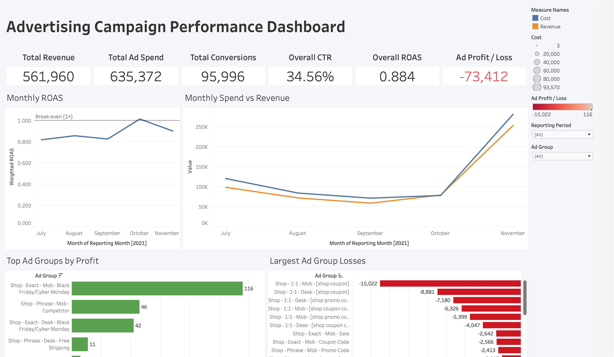
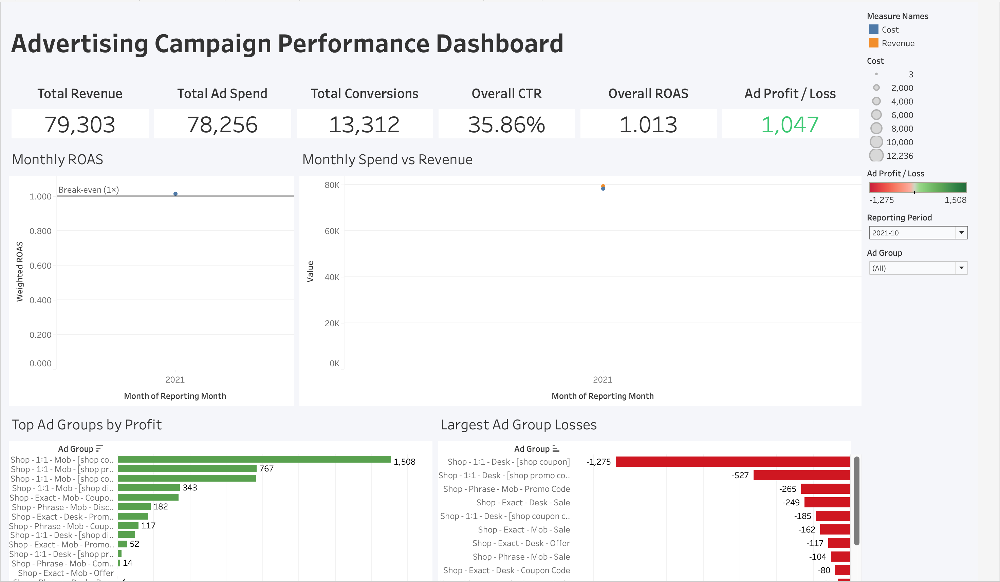

# Advertising Campaign Performance Dashboard

An end-to-end analysis of paid-search advertising using Python, MySQL, SQL, and Tableau. The project compares ad-group profitability, engagement, and conversion efficiency to identify opportunities for controlled budget optimization.

## Interactive dashboard

The completed Tableau dashboard includes six KPI cards, six analytical charts, reporting-period and ad-group filters, and business insights. Filter behavior and KPI totals were checked using full-period, October-only, single-group, and combined-filter views.

**Final dashboard link:** (https://public.tableau.com/app/profile/nikhita.karthikesan/viz/AdvertisingCampaignAnalytics_17927052239570/Dashboard1?publish=yes)

### Dashboard preview



<!-- After adding the image to images/, replace the line above with:

-->

### Filtered view



<!-- After adding the image to images/, replace the line above with:

-->

## Business question

Which ad groups generate the strongest returns, which underperform, and where should a business investigate changes to its advertising budget?

## Key findings

The analysis covers **190 observations**, **40 ad groups**, and **July–November 2021**.

| Metric | Result |
|---|---:|
| Impressions | 2,674,699 |
| Clicks | 924,503 |
| Conversions | 95,996 |
| Advertising spend | 635,372 |
| Revenue | 561,960 |
| Advertising profit / loss | −73,412 |
| Click-through rate | 34.56% |
| Conversion rate | 10.38% |
| Cost per acquisition | 6.62 |
| Return on ad spend | 0.884× |

- **Revenue did not cover advertising spend:** overall advertising loss was 73,412.
- **October was the only profitable month:** profit was 1,047, with ROAS of 1.013×.
- **The largest-loss group lost 15,022:** `Shop - 1:1 - Mob - [shop coupon]` had above-average CTR but below-average conversion rate, making tracking and search-intent alignment useful areas to investigate.
- **The highest-profit group operated at very small scale:** it earned 116 on 44 spend and 24 conversions. This seasonal sample does not justify a large budget increase.

See [business insights](reports/business_insights.md) for supporting comparisons and recommendations. Monetary figures use source currency units; profit excludes overhead and other business costs.

## Data source and cleaning

Source: [Shopping Mall Paid Search Campaign Dataset on Kaggle](https://www.kaggle.com/datasets/marceaxl82/shopping-mall-paid-search-campaign-dataset).

The raw dataset has 190 rows and 12 columns. The cleaning notebook preserves supplied KPIs as `source_*` fields and recalculates reporting metrics from counts and amounts, producing 19 columns. Validation checks required values, nonnegative counts/cost/revenue, valid dates, unique ad-group/month keys, and clicks no greater than impressions.

Supplied metrics differ from recalculated values: maximum absolute differences are 0.005 for CTR, 0.25 for conversion rate, 0.286667 for CPC, and 0.499 for profit/loss. Reporting uses the recalculated metrics. Seven zero-conversion observations retain undefined CPA as NULL.

Revenue and Sale Amount remain separate; ROAS uses **Revenue**. Currency and the interpretation of Revenue as commission income have not been independently confirmed against a primary data dictionary. The raw file contains month names without a year; 2021 is consistent with the [dataset author's description](https://www.reddit.com/r/datascienceproject/comments/xtjliu). Dataset use and redistribution remain subject to the original source terms.

## Workflow and data model

```text
Raw CSV → Python cleaning → Validated campaign-month CSV
                            ├── MySQL fact table → SQL reporting views
                            └── Tableau exports → Interactive dashboard
```

**Tools:** Python, pandas, NumPy, Jupyter, MySQL, SQL, and Tableau Public.

The fact table, `advertising_analytics.campaign_performance`, uses `(ad_group, reporting_month)` as its composite primary key. Counts use integers, monetary amounts and ratios use DECIMAL, and reporting months use DATE. Three reporting views expose monthly KPIs, ad-group KPIs, and campaign-month detail.

SQL analysis includes weighted aggregation, zero-denominator handling, `RANK` for comparisons, and `LAG` for monthly changes. SQL targets MySQL 8.0.16+ and was executed and verified on **MySQL 9.4.0**; 8.x was not separately tested.

## KPI definitions

| KPI | Calculation |
|---|---|
| CTR | SUM(clicks) / SUM(impressions) |
| Conversion rate | SUM(conversions) / SUM(clicks) |
| CPC | SUM(cost) / SUM(clicks) |
| CPA | SUM(cost) / SUM(conversions) |
| ROAS | SUM(revenue) / SUM(cost) |
| Advertising profit / loss | SUM(revenue) − SUM(cost) |

Ratios use aggregated totals rather than averages of row-level ratios. Zero denominators produce NULL. Rates are displayed as percentages and ROAS as a multiplier.

All interactive Tableau sheets use campaign-month detail to support both filters without duplicating totals. The efficiency chart screens for at least 1,000 spend within the active selection. This is an analytical threshold, not a confidence measure. Static business insights are explicitly labeled as full-period findings.

## Repository structure

```text
data/raw/                         Source data
data/processed/                   Cleaned campaign-month data
notebooks/data_cleaning.ipynb      Inspection and cleaning
scripts/                          Reporting, import, and MySQL verification
sql/                              Schema, validation, analysis, and views
tableau/                          Dashboard datasets and implementation guide
reports/                          Business analysis and validation evidence
tests/                            Regression tests and independent audit
PROJECT_AUDIT.md                   Validation summary
```

## Reproduce the project

Use Python 3.10+ for a new environment. Recorded validation used Python 3.9.6, pandas 2.3.3, and NumPy 2.0.2; a fresh environment was not separately tested.

From the repository root:

```sh
python3 -m venv .venv
.venv/bin/python -m pip install -r requirements.txt
.venv/bin/python scripts/reporting.py
.venv/bin/python scripts/import_mysql.py --dry-run
.venv/bin/python -m unittest discover -s tests -v
```

The reporting script validates the cleaned CSV against the raw-data transformation and generates:

| Tableau export | Grain | Rows |
|---|---|---:|
| tableau_campaign_month.csv | Ad group × reporting month | 190 |
| tableau_monthly_kpis.csv | Reporting month | 5 |
| tableau_ad_group_kpis.csv | Ad group | 40 |

Files are written to `tableau/`. Use the detail file for dashboard interactions and the summaries for reconciliation; do not join different grains.

For interactive notebook work, install `notebook` and `ipykernel`, then launch Jupyter from `notebooks/` using the project environment. The notebook expects that working directory; scripts resolve paths relative to the repository.

### MySQL verification

Follow [MySQL setup](reports/mysql_setup.md) to create a scoped account and configure `.env` from `.env.example`. Credentials are excluded from version control.

```sh
.venv/bin/python scripts/verify_mysql.py
```

The verifier executes the schema, imports twice, creates views, runs all validation and analysis SQL, and compares server results with independent CSV calculations. To execute manually, use this order: schema → Python import → reporting views → validation → KPI analysis.

Imports upsert matching keys transactionally and verify every stored field before committing. Unrelated records cause a mismatch rather than being deleted. DDL commits independently; incompatible existing schemas require manual review.

### Independent validation

```sh
.venv/bin/python tests/audit_project.py
```

The audit executes all 19 notebook code cells in an isolated copy and reconciles 190 detail rows, 45 summary rows, and 200 month/group selections using Decimal arithmetic. Run without Python's `-O` option because validation uses assertions.

The [validation summary](PROJECT_AUDIT.md) links to recorded evidence. Live MySQL checks confirmed 190 records, zero validation exceptions, nine analytical result sets, and 45 matching summary-view rows. Dashboard formulas and visual test cases are documented in the [Tableau guide](tableau/dashboard_build_guide.md).

## Limitations

The dataset contains five months of observational aggregates with unequal group coverage and no attribution window, customer lifetime value, or incremental-return measurement. Missing combinations are absent observations, not zero performance. Historical ROAS does not establish how additional budget would perform; recommendations require investigation and controlled experiments.
